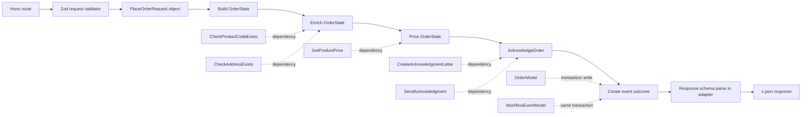

# 1. Pipeline Composition

## Overview

- Start from one workflow such as `PlaceOrder` and leave error handling aside at first, so the dependency shape and pipeline composition stay visible.
- Implement simple constrained values first, then let function signatures guide the implementation.
- Build `ValidateOrder`, then `PriceOrder`, `AcknowledgeOrder`, and `CreateEvents`.
- Compose the steps by binding dependencies first, then threading the workflow value through single-argument functions.
- Prefer explicit dependency injection and easy tests using fake dependency functions.

- Use Zod object schemas with inline field constraints and boundary parse.
- Do not create handcrafted branded primitive types.
- Use function type aliases before function bodies.
- Use context-owned model dependencies for persistence-facing reads/writes; use function dependencies for external checks, clocks, gateways, logging, and other edge effects.
- Use `makePlaceOrderWorkflow(deps)` to bind dependencies before the workflow runs.
- Keep raw request/response values at Zod boundaries. Core logic should only work with parsed workflow states.

## 1.1 Simple Values

- Constrain every simple value once, where it enters the system.
- Unconstrained raw values must not spread through the workflow.

```ts
import { z } from "zod";

export const OrderLineSchema = z.object({
  orderLineId: z.string().ulid(),
  productCode: z.string().min(1).max(50),
  quantity: z.number().positive(),
});

export const PriceAmountSchema = z.number().nonnegative();
```

Rule: parse at request/response boundaries, then pass parsed workflow states. Do not add extra request wrapper objects or standalone ID aliases such as `OrderId`, `CustomerId`, or `InvoiceId`; use `z.string().ulid()` directly on schema fields.

## 1.2 Implement From Function Types

- Declare a function type, then implement a value with that type so type checking catches dependency and state-shape mistakes inside the implementation.
- `ValidateOrder` is modeled as dependencies followed by workflow value transformation.

```ts
export type CheckProductCodeExists = (productCode: string) => Promise<void>;
export type CheckAddressExists = (address: AddressState) => Promise<CheckedAddressState>;

export type BuildOrderState = (request: PlaceOrderRequest) => OrderState;
export type EnrichOrderState = (deps: EnrichedOrderStateDependencies, state: OrderState) => Promise<EnrichedOrderState>;
```

Rule: dependencies may throw domain/infrastructure errors. Keep function signatures readable. Prefer existing context models for database reads/writes instead of inventing another persistence abstraction.

## 1.3 Validation Step

- `ValidateOrder` converts an unvalidated order into a validated order.
- Address validation delegates to `CheckAddressExists` and then converts checked address data into an internal address type.
- Order lines are mapped one by one; product code existence is checked as part of constructing validated lines.
- Quantity validation depends on product code rules, such as special handling for unit vs kilogram products.
- Turn yes/no checks into validators that pass the original value on, so the pipeline keeps its shape.

```ts
export const PlaceOrderRequestSchema = z.object({
  orderId: z.string().ulid(),
  customer: z.object({
    firstName: z.string().min(1).max(50),
    lastName: z.string().min(1).max(50),
    emailAddress: z.string().email(),
  }),
  shippingAddress: AddressSchema,
  lines: z.array(OrderLineSchema).min(1),
  promotionCode: z.string().min(1).optional(),
});

export type PlaceOrderRequest = z.infer<typeof PlaceOrderRequestSchema>;

export type OrderState = Readonly<{
  orderId: string;
  customer: PlaceOrderRequest["customer"];
  shippingAddress: PlaceOrderRequest["shippingAddress"];
  lines: PlaceOrderRequest["lines"];
  pricing: { readonly type: "Standard" } | { readonly type: "Promotion"; readonly promotionCode: string };
}>;

export type EnrichedOrderStateDependencies = Readonly<{
  checkProductCodeExists: CheckProductCodeExists;
  checkAddressExists: CheckAddressExists;
}>;

export const buildOrderState: BuildOrderState = (request) => ({
  orderId: request.orderId,
  customer: request.customer,
  shippingAddress: request.shippingAddress,
  lines: request.lines,
  pricing: request.promotionCode
    ? { type: "Promotion", promotionCode: request.promotionCode }
    : { type: "Standard" },
});

export const enrichOrderState: EnrichOrderState = async (deps, state) => {
  const checkedShippingAddress = await deps.checkAddressExists(state.shippingAddress);

  for (const line of state.lines) {
    await deps.checkProductCodeExists(line.productCode);
  }

  return {
    ...state,
    shippingAddress: checkedShippingAddress,
  };
};
```

Rule: structural validation belongs in the Zod parser. Core functions should build or transform states. External checks enrich the state; they should not introduce extra wrapper concepts.

## 1.4 Remaining Steps

- `PriceOrder` depends on `GetProductPrice`, maps each validated line into a priced line, computes line prices, and sums prices into an amount to bill.
- `AcknowledgeOrder` depends on letter creation and sending functions; it returns an optional acknowledgment event depending on send success.
- `CreateEvents` always includes order placed, optionally includes acknowledgment sent, and optionally includes billable order placed when the billing amount is non-zero.
- Optional events are lifted into the common event union.

```ts
export type GetProductPrice = (productCode: string) => number;

export type PriceOrder = (
  getProductPrice: GetProductPrice,
  state: EnrichedOrderState,
) => PricedOrderState;

export const priceOrderState: PriceOrder = (getProductPrice, state) => {
  const lines = state.lines.map((line) => priceOrderLine(getProductPrice, line));
  return {
    ...state,
    lines,
    amountToBill: sumPrices(lines.map((line) => line.linePrice)),
  };
};

export type PlaceOrderEvent =
  | { readonly type: "OrderPlaced"; readonly order: PricedOrder }
  | { readonly type: "AcknowledgmentSent"; readonly acknowledgment: OrderAcknowledgmentSent }
  | { readonly type: "BillableOrderPlaced"; readonly order: BillableOrderPlaced };

export const createEvents = (
  order: PricedOrderState,
  acknowledgment?: OrderAcknowledgmentSent,
): readonly PlaceOrderEvent[] => [
  { type: "OrderPlaced", order },
  ...(acknowledgment ? [{ type: "AcknowledgmentSent" as const, acknowledgment }] : []),
  ...createBillingEvent(order).map((billable) => ({ type: "BillableOrderPlaced" as const, order: billable })),
];
```

Rule: event creation should lift each concrete event into the shared workflow event union.

## 1.5 Compose The Pipeline

- Direct composition fails when each step has extra dependency arguments.
- Bind dependencies first, so each step becomes a single-state transition function.
- The assembled workflow then threads the order through validate, price, acknowledge, and create events.

```ts
export type PlaceOrderDependencies = Readonly<{
  orderModel: typeof OrderModel;
  workflowEventModel: typeof WorkflowEventModel;
  checkProductCodeExists: CheckProductCodeExists;
  checkAddressExists: CheckAddressExists;
  getProductPrice: GetProductPrice;
  createAcknowledgmentLetter: CreateOrderAcknowledgmentLetter;
  sendAcknowledgment: SendOrderAcknowledgment;
}>;

export const PlaceOrderResponseSchema = z.object({
  events: z.array(z.discriminatedUnion("type", [
    z.object({ type: z.literal("OrderPlaced"), orderId: z.string().ulid() }),
    z.object({ type: z.literal("AcknowledgmentSent"), orderId: z.string().ulid() }),
    z.object({ type: z.literal("BillableOrderPlaced"), orderId: z.string().ulid(), amountToBill: z.number().nonnegative() }),
  ])),
});

export type PlaceOrderResponse = z.infer<typeof PlaceOrderResponseSchema>;

export type PlaceOrderOutcome = Readonly<{
  events: readonly PlaceOrderEvent[];
}>;

export const eventToResponse = (
  event: PlaceOrderEvent,
): PlaceOrderResponse["events"][number] => {
  switch (event.type) {
    case "OrderPlaced":
      return { type: "OrderPlaced", orderId: event.order.orderId };
    case "AcknowledgmentSent":
      return { type: "AcknowledgmentSent", orderId: event.acknowledgment.orderId };
    case "BillableOrderPlaced":
      return {
        type: "BillableOrderPlaced",
        orderId: event.order.orderId,
        amountToBill: event.order.amountToBill,
      };
  }
};

export const makePlaceOrderCore = (deps: PlaceOrderDependencies) => {
  const enrich = (state: OrderState) => enrichOrderState(deps, state);
  const price = (state: EnrichedOrderState) => priceOrderState(deps.getProductPrice, state);
  const acknowledge = (state: PricedOrderState) =>
    acknowledgeOrder(deps.createAcknowledgmentLetter, deps.sendAcknowledgment, state);

  return async (request: PlaceOrderRequest): Promise<PlaceOrderOutcome> => {
    const state = buildOrderState(request);
    const enriched = await enrich(state);
    const priced = price(enriched);
    const acknowledgment = await acknowledge(priced);
    const events = createEvents(priced, acknowledgment);

    await deps.orderModel.transaction(async (tx) => {
      await deps.orderModel.createPlacedOrder(tx, priced);
      await deps.workflowEventModel.createMany(tx, events);
    });

    return { events };
  };
};

export const placeOrderResponseFromState = (
  state: PlaceOrderOutcome,
): PlaceOrderResponse =>
  PlaceOrderResponseSchema.parse({
    events: state.events.map((event) => eventToResponse(event)),
  });
```

Mermaid:



Hono adapter:

```ts
import { zValidator } from "@hono/zod-validator";
import { Hono } from "hono";

export const makePlaceOrderRoutes = (deps: PlaceOrderDependencies) => {
  const app = new Hono();
  const placeOrderCore = makePlaceOrderCore(deps);

  app.post("/orders", zValidator("json", PlaceOrderRequestSchema), async (c) => {
    const request = c.req.valid("json");
    const responseState = await placeOrderCore(request);
    return c.json(placeOrderResponseFromState(responseState));
  });

  return app;
};
```

Rule: framework adapters own request parsing and response validation. Core workflow functions accept parsed request objects and return workflow outcomes.

## 1.6 Dependency Injection

- Functional dependency injection is explicit argument passing, not hidden global dependency lookup.
- Dependencies may be passed through multiple lower-level functions.
- If dependency count grows, bind configuration at the edge and pass already-specialized functions inward.
- The web/app boundary constructs real dependencies, binds them, and then passes parsed request data through the workflow state pipeline.
- For application persistence, use context-owned models that expose both read and write operations, matching the local codebase's model layer. Do not add another persistence abstraction only to satisfy a pattern name.

```ts
export const buildPlaceOrderDependencies = (config: AppConfig): PlaceOrderDependencies => {
  const addressClient = makeAddressClient(config.addressService);

  return {
    orderModel: OrderModel,
    workflowEventModel: WorkflowEventModel,
    checkProductCodeExists: makeCheckProductCodeExists(ProductModel),
    checkAddressExists: makeCheckAddressExists(addressClient),
    getProductPrice: makeGetProductPrice(config.pricing),
    createAcknowledgmentLetter,
    sendAcknowledgment: makeSendAcknowledgment(config.mailer),
  };
};
```

Rule: inject existing context models for persistence-facing reads/writes, and inject domain-shaped functions for external services or policies. Do not pass raw clients, credentials, framework request objects, or newly invented persistence wrappers into core workflow code.

## 1.6.1 Long Orchestration Sub-Workflows

- Keep the workflow readable by binding dependencies first and then threading a single workflow value through named steps.
- When a step itself grows because it coordinates several dependency calls, treat that step as another explicit workflow slice instead of burying the branch inside the main function.

Use one object argument when the extracted step needs several values and edge callbacks. Keep the call site readable by binding raw clients in closures at the adapter/composition boundary.

```ts
export type DormantBillingProfileReconciliationInput = Readonly<{
  tenantId: string;
  currentProfile: BillingProfileState;
  pendingInvoiceId: string | null;
  closePendingInvoice: (invoiceId: string) => Promise<void>;
  createBillingProfile: () => Promise<BillingProfileState>;
  syncPaymentProviderProfile: () => Promise<BillingProfileState>;
  logger: Pick<Logger, "warning">;
}>;

export type DormantBillingProfileReconciliationState = Readonly<{
  billingProfile: BillingProfileState;
  reconciliation: "not-needed" | "dormant-profile-recreated";
}>;

export const reconcileDormantBillingProfile = async ({
  tenantId,
  currentProfile,
  pendingInvoiceId,
  closePendingInvoice,
  createBillingProfile,
  syncPaymentProviderProfile,
  logger,
}: DormantBillingProfileReconciliationInput): Promise<DormantBillingProfileReconciliationState> => {
  if (currentProfile.status !== "dormant") {
    return {
      billingProfile: currentProfile,
      reconciliation: "not-needed",
    };
  }

  if (pendingInvoiceId) {
    await closePendingInvoice(pendingInvoiceId);
  }

  await createBillingProfile();
  const billingProfile = await syncPaymentProviderProfile();
  logger.warning("Recreated dormant billing profile during checkout preparation");

  return {
    billingProfile,
    reconciliation: "dormant-profile-recreated",
  };
};

const { billingProfile } = await reconcileDormantBillingProfile({
  tenantId: tenant.id,
  currentProfile,
  pendingInvoiceId: pendingInvoice?.id ?? null,
  closePendingInvoice: (invoiceId) =>
    BillingInvoiceModel.closePendingInvoice(invoiceId),
  createBillingProfile: () => createBillingProfile(paymentGateway, tenant.id),
  syncPaymentProviderProfile: () =>
    syncPaymentProviderProfile(paymentGateway, tenant),
  logger: { warning: logger.warning },
});
```

Rule: extract long conditional/effect-heavy branches into named sub-workflows when doing so makes the main workflow read as a sequence of business decisions. Do not create generic `helper` or `utility` modules; name the function and file after the specific domain operation. Pass dependency callbacks, not raw clients, and return a state/result object that the next workflow step can consume.

## 1.7 Testing Dependencies

- Explicit dependency arguments make tests simple: pass stub functions for product/address checks.
- Test both success and failure by changing dependency behavior.

```ts
it("enriches the state when product and address dependencies accept it", async () => {
  const deps: EnrichedOrderStateDependencies = {
    checkProductCodeExists: async () => undefined,
    checkAddressExists: async (address) => checkedAddressFrom(address),
  };

  const state = buildOrderState(PlaceOrderRequestSchema.parse(validRequest));
  await expect(enrichOrderState(deps, state)).resolves.toMatchObject({
    orderId: state.orderId,
  });
});

it("fails enrichment when product code dependency rejects a line", async () => {
  const deps: EnrichedOrderStateDependencies = {
    checkProductCodeExists: async () => {
      throw new ProductCodeNotFoundError("missing product");
    },
    checkAddressExists: async (address) => checkedAddressFrom(address),
  };

  const state = buildOrderState(PlaceOrderRequestSchema.parse(validRequest));
  await expect(enrichOrderState(deps, state)).rejects.toBeInstanceOf(ProductCodeNotFoundError);
});
```

## 1.8 Assembled Pipeline

- The assembled module groups public workflow types, dependency types, step implementations, and helper conversions.
- The public workflow should expose the business-level workflow, not internal helper functions.

- `place-order/schemas.ts`: Zod request/response schemas.
- `place-order/workflow-state.ts`: workflow state shapes and transformations.
- `place-order/dependencies.ts`: context model dependencies plus function dependencies for external effects.
- `place-order/enrichment.ts`: external checks that enrich the state.
- `place-order/pricing.ts`: pricing step.
- `place-order/acknowledgment.ts`: acknowledgment step.
- `place-order/core.ts`: `makePlaceOrderCore`.
- `place-order/workflow.test.ts`: schema and dependency-driven tests.
