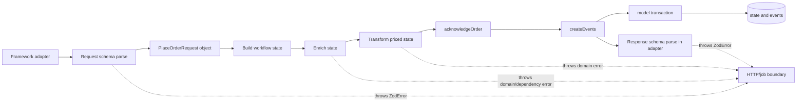

# 2. Errors And Effects

## Overview

- Make error handling explicit once the pipeline shape is in place.
- Treat expected business failures as first-class outcomes, not hidden surprises.
- Avoid scattering conditional branches across the steps.
- Adapt exception-throwing functions and side-effect-only functions into the workflow.
- Handle validation accumulation and async effects last.

- Do not create a custom `Result<T, E>` type for this skill.
- Use Zod schemas to parse untrusted requests and validate responses at boundaries.
- Use ordinary return values for successful domain functions.
- Use domain-specific `Error` subclasses or typed error objects thrown at adapters when a dependency fails.
- Let HTTP/job/message handlers translate `ZodError` and domain errors into responses, retries, dead letters, or logs.
- Persistence effects should go through context-owned models. Expected missing-state outcomes from model reads can become skipped variants; unexpected model/database failures can throw to the adapter.
- In CLI/job/message workflows, return explicit response variants for expected business outcomes: `skipped` for permanent no-op, `pending` for not-ready-yet, and `retryable` when the adapter should choose a retry mechanism. Do not throw these from core logic.
- When an HTTP adapter converts a response variant into a custom error, separate the stable business code from the transport status. Allow a status override so data inconsistency can be surfaced as HTTP 500 even when the domain reason is a not-found shape.
- Use `Promise<T>` for async effects; do not wrap every async result in a custom container.

## 2.1 Explicit Failure Contracts Without Result

- Function types should communicate whether a call can fail and why.
- Address validation, for example, should show in its type that it can fail.

```ts
import { z } from "zod";

export class AddressValidationError extends Error {
  constructor(
    readonly reason: "InvalidFormat" | "AddressNotFound",
    message: string,
  ) {
    super(message);
  }
}

export type CheckAddressExists = (
  address: AddressState,
) => Promise<CheckedAddressState>;
```

Rule: the port name and error class describe failure. Do not return booleans or a generic `Error`.

## 2.2 Domain Error Categories

- Separate expected domain failures, programmer/panic failures, and infrastructure failures.
- Expected domain failures should be modeled intentionally.
- Unrecoverable technical failures can be handled at high-level boundaries.

```ts
export class ValidationFailedError extends Error {
  constructor(readonly issues: readonly DomainValidationIssue[]) {
    super("Validation failed");
  }
}

export class PricingFailedError extends Error {
  constructor(readonly productCode: string, message: string) {
    super(message);
  }
}

export class RemoteServiceError extends Error {
  constructor(readonly service: string, readonly cause: unknown) {
    super(`Remote service failed: ${service}`);
  }
}
```

Rule: use named error classes or typed error objects where callers need different handling. Keep truly unexpected bugs as ordinary thrown errors.

## 2.3 Success And Failure Paths As Boundary Control Flow

- A workflow has a success path and a failure path. Once a step fails, later domain steps are skipped.

```ts
export const placeOrder = async (
  deps: PlaceOrderDependencies,
  request: PlaceOrderRequest,
): Promise<PlaceOrderOutcome> => {
  const state = buildOrderState(request);
  const enriched = await enrichOrderState(deps, state);
  const priced = priceOrderState(deps.getPricingFunction, enriched);
  const acknowledgment = await acknowledgeOrder(deps, priced);
  const events = createEvents(priced, acknowledgment);

  await deps.orderModel.transaction(async (tx) => {
    await deps.orderModel.createPlacedOrder(tx, priced);
    await deps.workflowEventModel.createMany(tx, events);
  });

  return { events };
};
```

Mermaid:



Rule: TypeScript keeps the happy path readable; framework/message adapters own request parsing, response validation, and error translation. If events are persisted, save them in the same transaction as the state change that produced them.

## 2.3.1 CLI And Job Outcomes

- Expected failures should be first-class outcomes, not hidden surprises.
- Boundary code decides how to translate workflow outcomes into HTTP responses, job retries, dead letters, process exit codes, or logs.

```ts
export type JobWorkflowResponse =
  | { readonly status: "completed"; readonly processedCount: number }
  | { readonly status: "skipped"; readonly reason: "MissingTarget" | "AlreadyProcessed" }
  | { readonly status: "pending"; readonly reason: "ParentMessageNotLinked" }
  | { readonly status: "retryable"; readonly reason: "RemoteRateLimited" };

export const runJobCore = async (
  request: ParsedJobRequest,
): Promise<JobWorkflowResponse> => {
  const state = buildJobState(request);
  if (!state.target) return { status: "skipped", reason: "MissingTarget" };
  if (!state.parentLinked) return { status: "pending", reason: "ParentMessageNotLinked" };
  return { status: "completed", processedCount: 1 };
};
```

Rule: core workflows invoked from CLI, queue workers, scheduled jobs, or message handlers should return discriminated response variants for expected business preconditions. The adapter may convert `pending`/`retryable` into a queue retry throw if the queue framework requires it.

## 2.3.2 Adapter Error Translation And Status Override

- Boundary code decides how workflow outcomes are represented outside the domain workflow.
- Expected failures should remain explicit so callers can choose an appropriate response, retry, or alert path.

```ts
type HttpStatus = 400 | 401 | 403 | 404 | 409 | 500;

class NotFoundError extends Error {
  readonly code = "NOT_FOUND";

  constructor(
    message: string,
    readonly options: { statusOverride?: HttpStatus } = {},
  ) {
    super(message);
  }
}

const throwSkippedCheckoutPreparation = (
  skipped:
    | { readonly reason: "checkout-session-not-found"; readonly message: string }
    | { readonly reason: "billing-profile-not-found"; readonly message: string },
): never => {
  if (skipped.reason === "billing-profile-not-found") {
    throw new NotFoundError(skipped.message, { statusOverride: 500 });
  }

  throw new NotFoundError(skipped.message);
};
```

Rule: keep the domain reason stable and explicit. Use transport status override only at the adapter boundary, and only when the external semantics differ from the domain reason, such as missing referenced data indicating server-side inconsistency rather than user-facing 404.

## 2.4 Adapting Different Error Sources

- Adapt functions with different failure types into a common workflow failure type.

```ts
export const makeCheckAddressExists =
  (client: AddressClient): CheckAddressExists =>
  async (address) => {
    try {
      const response = await client.verify(address);
      if (!response.found) {
        throw new AddressValidationError("AddressNotFound", "Address was not found");
      }
      return CheckedAddressSchema.parse(response.normalizedAddress);
    } catch (error) {
      if (error instanceof AddressValidationError) throw error;
      throw new RemoteServiceError("address-service", error);
    }
  };
```

Rule: adapt third-party and infrastructure failures at the port implementation, not inside the pure domain step.

## 2.5 Side-Effect-Only Functions

- Adapt side-effect-only functions so they fit into the workflow without losing the value being processed.

```ts
export const tapAsync =
  <T>(effect: (value: T) => Promise<void>) =>
  async (value: T): Promise<T> => {
    await effect(value);
    return value;
  };
```

Rule: use `tapAsync` sparingly for logging, publishing, or metrics when it improves readability; prefer explicit statements for business effects.

## 2.6 Validation Accumulation

- Some independent validations should collect all errors instead of failing at the first one.

- Prefer Zod object schemas for independent request/response validation. Zod accumulates field issues by default.
- Use `.superRefine` for cross-field rules.

```ts
export const PlaceOrderRequestSchema = z.object({
  orderId: z.string().ulid(),
  customerId: z.string().ulid(),
  lines: z.array(OrderLineSchema).min(1),
  shippingAddress: AddressSchema,
  promotionCode: z.string().min(1).optional(),
}).superRefine((value, ctx) => {
  const productCodes = new Set(value.lines.map((line) => line.productCode));
  if (productCodes.size !== value.lines.length) {
    ctx.addIssue({
      code: "custom",
      message: "Duplicate product codes are not allowed in this workflow slice",
      path: ["lines"],
    });
  }
});

export const PlaceOrderResponseSchema = z.object({
  events: z.array(PlaceOrderEventSchema),
});
```

Rule: parse untrusted requests once in the framework/message adapter, then pass the parsed object to core. Validate responses before returning/publishing. After parse, do not re-check the same structural constraints in the workflow state pipeline.

## 2.7 Async Effects

- Async dependencies must be visible in the function type.

```ts
export type PlaceOrderDependencies = Readonly<{
  customerModel: typeof CustomerModel;
  orderModel: typeof OrderModel;
  workflowEventModel: typeof WorkflowEventModel;
}>;
```

Rule: use `Promise<T>` for async model methods and let unexpected thrown errors flow to the composition boundary unless the local codebase has a different standard. Use the model layer for both reads and writes; do not introduce another persistence abstraction just to name persistence operations.
