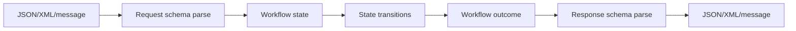

# 3. Boundary Schemas And Serialization

## Overview

- Serialization converts rich domain values to simpler external representations such as JSON/XML/protobuf and back.
- Domain types should not cross process or bounded-context boundaries directly.
- Plain boundary payloads sit at boundaries; conversion functions mediate between payloads and workflow states.
- Outbound conversion from workflow state to response payload usually succeeds.
- Inbound conversion may fail because external data is untrusted.
- Boundary schemas are contracts between bounded contexts and must evolve carefully.
- Common domain shapes map to external payload shapes as listed below.

- Boundary request/response payloads should be JSON-safe, plain, and framework-friendly.
- Use Zod schemas as parsers for inbound requests and validators for outbound responses.
- Use `z.infer<typeof Schema>` for parsed types.
- Use `.transform` when parse should produce a workflow state.
- Use direct functions for outbound workflow-state-to-response conversion, then validate with the response schema.
- Contract versioning belongs in boundary schema modules, not core logic modules.
- Keep boundary request/response schemas separate from persistence record schemas. Context models may own record parsing and write-shape conversion for both reads and writes.

## 3.1 Boundary Schema

- Outbound path: workflow state -> response payload -> serialized string/message.
- Inbound path: serialized string/message -> request payload -> workflow state.
- Boundary schemas isolate workflow states from the representation needs of external systems.

```ts
import { z } from "zod";

export type JsonString = string;

export type ParseRequest<RequestState> = (json: JsonString) => RequestState;
export type BuildResponse<CoreState, ResponsePayload> = (state: CoreState) => ResponsePayload;
export type SerializeResponse<ResponsePayload> = (payload: ResponsePayload) => JsonString;
```

Mermaid:



## 3.2 Serialization Pipeline Around Workflow

- The workflow can remain a workflow state transition.
- A wrapper handles deserialization, request schema parse, workflow call, response construction, response schema validation, and serialization.

```ts
export const makeWorkflowWithSerialization =
  <RequestState, CoreResultState, ResponsePayload>(
    parseRequest: (json: JsonString) => RequestState,
    workflow: (state: RequestState) => CoreResultState,
    buildResponse: BuildResponse<CoreResultState, ResponsePayload>,
    validateResponse: (payload: ResponsePayload) => ResponsePayload,
    serializeResponse: SerializeResponse<ResponsePayload>,
  ) =>
  (json: JsonString): JsonString => {
    const requestState = parseRequest(json);
    const resultState = workflow(requestState);
    const response = validateResponse(buildResponse(resultState));
    return serializeResponse(response);
  };
```

Rule: keep serialization wrapping outside the workflow. Boundary code catches `SyntaxError` and `ZodError`.

## 3.3 End-To-End Example

- A `Person` has a name of at most 50 characters and a birthdate.
- The request schema parses plain strings into that state, with the constraints written inline.
- The response is built from the state with primitive values only, then validated.
- JSON parsing and serialization stay in these boundary functions, never in the domain.

```ts
export const PersonRequestSchema = z.object({
  first: z.string().min(1).max(50),
  last: z.string().min(1).max(50),
  birthdate: z.coerce.date().min(new Date("1900-01-01")),
}).transform((payload) => ({
  first: payload.first,
  last: payload.last,
  birthdate: payload.birthdate,
}));

export type PersonState = z.infer<typeof PersonRequestSchema>;

export const PersonResponseSchema = z.object({
  first: z.string(),
  last: z.string(),
  birthdate: z.string(),
});

export type PersonResponse = z.infer<typeof PersonResponseSchema>;

export type PersonResponsePayload = Readonly<{
  first: string;
  last: string;
  birthdate: string;
}>;

export const personToResponse = (person: PersonState): PersonResponse => PersonResponseSchema.parse({
  first: person.first,
  last: person.last,
  birthdate: person.birthdate.toISOString(),
});

export const personFromJson = (json: JsonString): PersonState =>
  PersonRequestSchema.parse(JSON.parse(json));
```

Rule: inbound parse builds the workflow state. Outbound response is validated before return/publish.

## 3.3.1 Model Record Schemas

- Serialization keeps external representations explicit and separated from the domain model.
- The same principle applies to persisted representations: database rows/documents are another serialized shape at the edge.

```ts
export const BillingProfileRecordSchema = z.object({
  id: z.string().ulid(),
  tenant_id: z.string().ulid(),
  status: z.enum(["active", "dormant"]),
  current_period_end: z.coerce.date(),
}).transform((record) => ({
  id: record.id,
  tenantId: record.tenant_id,
  status: record.status,
  currentPeriodEnd: record.current_period_end,
}));

export type BillingProfileState = z.infer<typeof BillingProfileRecordSchema>;

export const BillingProfileModel = {
  async findByTenantId(db: Database, tenantId: string): Promise<BillingProfileState | null> {
    const [record] = await db.select().from(billingProfile).where(eq(billingProfile.tenantId, tenantId));
    return record ? BillingProfileRecordSchema.parse(record) : null;
  },

  async create(db: Database, state: BillingProfileState): Promise<void> {
    await db.insert(billingProfile).values({
      id: state.id,
      tenantId: state.tenantId,
      status: state.status,
      currentPeriodEnd: state.currentPeriodEnd,
    });
  },
};
```

Rule: model modules can own both read parsing and write mapping for their persistence shape. Workflow code should depend on the model and parsed state values, not on table rows or extra persistence wrappers.

## 3.3.2 Versioned Boundary Schemas

- Boundary schemas are contracts, so changes can break other contexts.
- Multiple schema versions may be needed when external consumers still use old shapes.

```ts
export const PlaceOrderRequestV1Schema = z.object({
  orderId: z.string().ulid(),
  lines: z.array(OrderLineV1Schema).min(1),
}).transform((payload) => ({
  orderId: payload.orderId,
  customerId: "legacy-unknown",
  lines: payload.lines.map(orderLineV1ToV2),
  promotionCode: undefined,
}));

export const PlaceOrderRequestV2Schema = z.object({
  orderId: z.string().ulid(),
  customerId: z.string().ulid(),
  lines: z.array(OrderLineV2Schema).min(1),
  promotionCode: z.string().min(1).optional(),
});
```

Rule: version migration must be explicit and documented.

## 3.4 Workflow State Shape To Boundary Schema

Mapping:

- Constrained simple value -> its primitive (`string`, `number`) with the constraint in the schema.
- Optional value -> `null` or a nullable field.
- Object -> boundary object with converted fields.
- Array -> array, or another explicit representation.
- `Map` -> array of key/value pairs, chosen deliberately.
- String literal union -> `z.enum`, rejecting unknown values.
- Tuple -> named boundary object.
- Discriminated union with data -> explicit tag plus its payload, preferably as a tagged object.
- Dictionary-shaped payloads work but make the contract less explicit.
- Do not put a custom result container into a contract.

```ts
export const OptionalDescriptionSchema = z.string().nullable();

export const OrderLineSchema = z.object({
  orderLineId: z.number().int().positive(),
  productCode: z.string().min(1).max(50),
  quantity: z.number().positive().nullable(),
  description: OptionalDescriptionSchema,
});

export const PriceLookupSchema = z.object({
  pairs: z.array(z.object({
    key: z.string().min(1).max(50),
    value: z.number().nonnegative(),
  })),
});

export const CardSchema = z.object({
  suit: z.enum(["Heart", "Spade", "Diamond", "Club"]),
  rank: z.enum(["Ace", "Two", "Queen", "King"]),
});
```

For choice/state variant types, prefer discriminated schemas:

```ts
export const ExampleNodeSchema = z.discriminatedUnion("tag", [
  z.object({ tag: z.literal("A") }),
  z.object({ tag: z.literal("B"), data: z.number() }),
  z.object({ tag: z.literal("C"), data: z.array(z.string()) }),
  z.object({ tag: z.literal("D"), data: NameSchema }),
]);

export type ExampleNode = z.infer<typeof ExampleNodeSchema>;
```

Rule: prefer explicit discriminated schemas over many nullable fields when TypeScript controls the contract.

## 3.5 Where Serialization Lives

- Serialization happens only at the edge.

- Put request/response schemas and serializer code in `*.schema.ts` or `adapters/*`.
- Put persistence record schemas and row/document conversion in context model modules.
- Keep core domain modules free of JSON parser, HTTP request, table schema, and serializer imports unless that module is explicitly a boundary parser or context model.
