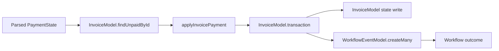
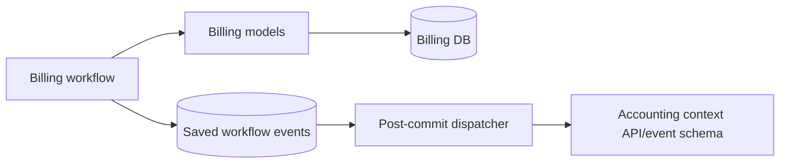

# 4. Persistence

## Overview

- Push persistence to the edge, keep business decisions explicit, separate reads from writes when that clarifies intent, and let each bounded context own its data store.
- When I/O is mixed into business logic, as in an invoice payment, extract a pure `applyPayment` decision.
- Decide storage ownership, relational/document mapping, event sourcing, CQRS, and transactions explicitly.

- Use context-owned `*Model` objects as the default persistence dependency.
- A model may own both reads and writes when the codebase already works that way.
- Model methods parse database rows/documents into state values and map state values back to write shapes.
- Workflow/core logic should depend on models and parsed workflow states, not table rows, raw ORM builders, or framework request objects.
- Persist emitted workflow/domain events in the same transaction as the state mutation that produced them.
- Publish, dispatch, or fan out saved events after commit when another process needs notification.

## 4.1 Persistence Boundary

- The domain decision should be separated from loading, saving, and transaction concerns.
- The edge workflow coordinates persistence, while the decision function transforms already-loaded domain values.

```ts
export type PaymentState = Readonly<{
  invoiceId: string;
  amount: number;
}>;

export type InvoicePaymentEvent =
  | { readonly type: "InvoicePartiallyPaid"; readonly invoiceId: string; readonly amountPaid: number }
  | { readonly type: "InvoiceFullyPaid"; readonly invoiceId: string };

export type InvoicePaymentDecision =
  | {
      readonly status: "partially-paid";
      readonly invoice: UnpaidInvoiceState;
      readonly events: readonly InvoicePaymentEvent[];
    }
  | {
      readonly status: "fully-paid";
      readonly invoiceId: string;
      readonly events: readonly InvoicePaymentEvent[];
    };

export const applyInvoicePayment = (
  invoice: UnpaidInvoiceState,
  payment: PaymentState,
): InvoicePaymentDecision => {
  const paidAmount = invoice.paidAmount + payment.amount;
  if (paidAmount >= invoice.totalAmount) {
    return {
      status: "fully-paid",
      invoiceId: invoice.id,
      events: [{ type: "InvoiceFullyPaid", invoiceId: invoice.id }],
    };
  }

  return {
    status: "partially-paid",
    invoice: { ...invoice, paidAmount },
    events: [{ type: "InvoicePartiallyPaid", invoiceId: invoice.id, amountPaid: payment.amount }],
  };
};
```

Rule: keep the business decision pure. It may return the next workflow state and events, but it should not load rows, open transactions, or publish messages.

## 4.2 Model Dependencies

- Persistence is an edge concern.
- Reads and writes can be shaped to the workflow's needs.
- Database representations require explicit conversion to domain values.

```ts
export const InvoiceRecordSchema = z.object({
  id: z.string().ulid(),
  tenant_id: z.string().ulid(),
  total_amount: z.number().nonnegative(),
  paid_amount: z.number().nonnegative(),
  status: z.enum(["unpaid", "paid"]),
}).transform((record) => ({
  id: record.id,
  tenantId: record.tenant_id,
  totalAmount: record.total_amount,
  paidAmount: record.paid_amount,
  status: record.status,
}));

export type InvoiceState = z.infer<typeof InvoiceRecordSchema>;

export const InvoiceModel = {
  async findUnpaidById(db: Database, invoiceId: string): Promise<UnpaidInvoiceState | null> {
    const [record] = await db
      .select()
      .from(invoice)
      .where(and(eq(invoice.id, invoiceId), eq(invoice.status, "unpaid")));

    return record ? UnpaidInvoiceSchema.parse(InvoiceRecordSchema.parse(record)) : null;
  },

  async updateUnpaid(tx: Transaction, invoiceState: UnpaidInvoiceState): Promise<void> {
    await tx
      .update(invoice)
      .set({ paidAmount: invoiceState.paidAmount })
      .where(eq(invoice.id, invoiceState.id));
  },

  async markFullyPaid(tx: Transaction, invoiceId: string): Promise<void> {
    await tx
      .update(invoice)
      .set({ status: "paid" })
      .where(eq(invoice.id, invoiceId));
  },

  transaction<T>(work: (tx: Transaction) => Promise<T>): Promise<T> {
    return createDb().transaction(work);
  },
};
```

Rule: the model owns read parsing and write mapping. Workflow code receives `typeof InvoiceModel`, not row objects or raw table operations.

## 4.3 Core Workflow With Model Reads

- Some workflows need loaded state before a decision can be made.
- Expected missing data should be explicit in the workflow outcome.

```ts
export type PayInvoiceDependencies = Readonly<{
  invoiceModel: typeof InvoiceModel;
  workflowEventModel: typeof WorkflowEventModel;
}>;

export type PayInvoiceWorkflowResponse =
  | { readonly status: "paid"; readonly events: readonly InvoicePaymentEvent[] }
  | { readonly status: "skipped"; readonly reason: "invoice-not-found"; readonly message: string };

export const makePayInvoiceCore =
  (deps: PayInvoiceDependencies, db: Database) =>
  async (payment: PaymentState): Promise<PayInvoiceWorkflowResponse> => {
    const invoiceState = await deps.invoiceModel.findUnpaidById(db, payment.invoiceId);
    if (!invoiceState) {
      return {
        status: "skipped",
        reason: "invoice-not-found",
        message: `Invoice not found: ${payment.invoiceId}`,
      };
    }

    const decision = applyInvoicePayment(invoiceState, payment);
    await saveInvoicePaymentDecision(deps, decision);

    return { status: "paid", events: decision.events };
  };
```

Rule: model reads can produce skipped workflow variants for expected business preconditions. Unexpected database/model failures should throw to the adapter or job boundary.

## 4.4 Transactional State And Event Save

- Some workflows require multiple writes to be atomic.
- Partial completion is a design risk that should be made explicit.

```ts
export const saveInvoicePaymentDecision = async (
  deps: PayInvoiceDependencies,
  decision: InvoicePaymentDecision,
): Promise<void> => {
  await deps.invoiceModel.transaction(async (tx) => {
    if (decision.status === "fully-paid") {
      await deps.invoiceModel.markFullyPaid(tx, decision.invoiceId);
    } else {
      await deps.invoiceModel.updateUnpaid(tx, decision.invoice);
    }

    await deps.workflowEventModel.createMany(tx, decision.events);
  });
};
```

Mermaid:



Rule: save workflow/domain events inside the same database transaction as the state write. If an external consumer needs the event, use the saved event/outbox record after commit.

## 4.5 Context-Owned Storage

- Each bounded context owns its data store and persistence schema.
- Other contexts should use APIs, request/response schemas, events, or contracts instead of directly reading another context's storage.

- Keep `*Model` modules under the bounded context or feature boundary that owns the tables/documents.
- Do not import another context's table schema into a workflow.
- When crossing contexts, emit consumer-shaped event schemas or call a boundary API.



Rule: model ownership follows bounded-context ownership. Cross-context communication uses schemas/events, not shared table access.

## 4.6 Read/Write Split And Event Sourcing

- CQRS separates read and write models when their needs differ.
- Event sourcing stores state changes as events and is useful when audit, history, or replay is required.

- Keep one model if it clearly owns both read and write paths.
- Split into read/write models only when query shape, performance, or ownership pressure requires it.
- Use event sourcing only when replay/history is a real requirement; otherwise, save workflow events as an audit/outbox stream alongside normal state tables.

```ts
export const InvoiceReadModel = {
  async findSummaryByTenantId(db: Database, tenantId: string): Promise<readonly InvoiceSummaryState[]> {
    const records = await db.select().from(invoiceSummary).where(eq(invoiceSummary.tenantId, tenantId));
    return z.array(InvoiceSummaryRecordSchema).parse(records);
  },
};

export const InvoiceWriteModel = {
  transaction<T>(work: (tx: Transaction) => Promise<T>): Promise<T> {
    return createDb().transaction(work);
  },

  async applyPaymentDecision(tx: Transaction, decision: InvoicePaymentDecision): Promise<void> {
    if (decision.status === "fully-paid") {
      await InvoiceModel.markFullyPaid(tx, decision.invoiceId);
    } else {
      await InvoiceModel.updateUnpaid(tx, decision.invoice);
    }
  },
};
```

Rule: split read/write models only when that split makes the implementation clearer. Do not add split models merely to mirror CQRS terminology.

## 4.7 Persistence Checklist

Before implementing persistence for a workflow, state:

- which context owns the model and storage;
- which model methods read required state;
- which model methods write new state;
- which database records are parsed into state values;
- which decision function remains pure;
- which emitted events are saved;
- which state writes and event writes are in the same transaction;
- whether post-commit dispatch/outbox is needed;
- which skipped variants represent expected missing or invalid persisted state;
- which unexpected model/database failures should throw to the boundary.
