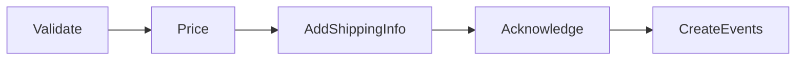
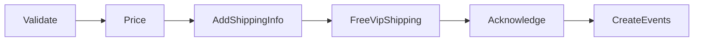
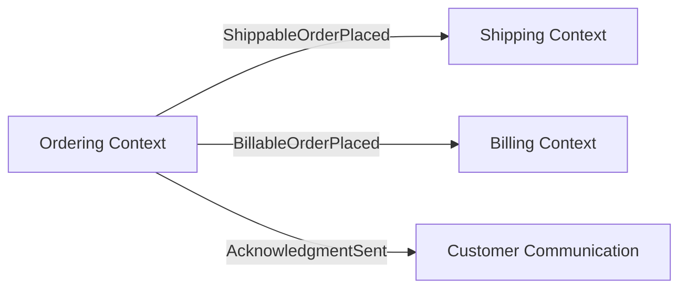

# 5. Evolving The Model

## Overview

- Strong types and pipelines keep requirement changes local.
- The sections below grow the order workflow with typical changes: shipping cost, VIP customers, promotion codes with their contract changes, and business hours.
- Each change should introduce explicit domain concepts, stages, and contracts rather than hidden conditionals.

- Add a Zod schema, parsed field, or discriminated union when the business names a concept.
- Add a pipeline stage when the workflow lifecycle changes.
- Add a model dependency or external-effect function when the new rule depends on external facts.
- Split response/event schemas by downstream consumer need.
- Update context models when a requirement changes persisted reads, writes, or transactionally saved workflow events.
- Use compiler errors as a guide when required fields or states change.

## 5.1 Shipping Cost

- A first implementation calculates shipping cost with nested country/state conditionals.
- Separate classifying the destination from pricing it.
- The workflow adds a new stage between pricing and acknowledgment: add shipping info.
- A new state variant `PricedOrderWithShippingInfoState` avoids pretending shipping info exists before the stage runs.

```ts
export type ShippingZone =
  | { readonly type: "UsLocalState" }
  | { readonly type: "UsRemoteState" }
  | { readonly type: "International" };

export const classifyShippingZone = (address: CheckedAddress): ShippingZone => {
  if (address.country !== "US") return { type: "International" };
  return ["CA", "OR", "AZ", "NV"].includes(address.state)
    ? { type: "UsLocalState" }
    : { type: "UsRemoteState" };
};

export const calculateShippingCost = (state: PricedOrderState): number => {
  switch (classifyShippingZone(state.shippingAddress).type) {
    case "UsLocalState":
      return 5;
    case "UsRemoteState":
      return 10;
    case "International":
      return 20;
  }
};

export type ShippingInfo = Readonly<{
  method: ShippingMethod;
  cost: number;
}>;

export type PricedOrderWithShippingInfoState = Readonly<{
  pricedOrder: PricedOrderState;
  shippingInfo: ShippingInfo;
}>;

export type AddShippingInfoToOrder = (
  state: PricedOrderState,
) => PricedOrderWithShippingInfoState;
```

Mermaid:



Rule: create a new state variant when a stage adds facts that should not exist earlier.

## 5.1.1 Reasons To Add Pipeline Stages

- Add a stage when new information is accumulated, when the state shape changes, or when a new business capability deserves a named step.

- Add a new transformation and a new state variant.
- Update `makeWorkflow` stage order and Mermaid diagram in the same change.

## 5.2 VIP Customer Handling

- VIP status is added to customer information.
- Adding a required field causes compiler errors where customer info is constructed.
- Request/response schemas must include the new field when it crosses a boundary.
- Free VIP shipping is modeled as a new workflow stage after shipping information exists.

```ts
export type VipStatus =
  | { readonly type: "Normal" }
  | { readonly type: "Vip" };

export type CustomerInfo = Readonly<{
  name: PersonalName;
  emailAddress: EmailAddress;
  vipStatus: VipStatus;
}>;

export type FreeVipShipping = (
  state: PricedOrderWithShippingInfoState,
) => PricedOrderWithShippingInfoState;

export const freeVipShipping: FreeVipShipping = (state) => {
  if (state.pricedOrder.customer.vipStatus.type !== "Vip") return state;
  return {
    ...state,
    shippingInfo: {
      ...state.shippingInfo,
      cost: 0,
    },
  };
};
```

Mermaid:



Rule: use a pipeline stage when the new rule depends on a fact produced by an earlier stage.

## 5.3 Promotion Codes

- Promotion code is an optional request field.
- The workflow state adds promotion code as an optional pricing concept.
- Rather than passing an optional promotion code everywhere, introduce `PricingMethod = Standard | Promotion`.
- `GetPricingFunction` maps `PricingMethod` to `GetProductPrice`.
- Price calculation uses the chosen pricing function.
- Discount/promotion display may require changing `PricedOrderLine` from a single product-line shape into a choice type with product lines and comment/discount lines.

```ts
export type PricingMethod =
  | { readonly type: "Standard" }
  | { readonly type: "Promotion"; readonly promotionCode: string };

export type GetProductPrice = (productCode: string) => number;
export type GetPricingFunction = (method: PricingMethod) => GetProductPrice;

export const getPricingFunction = (
  getStandardPrices: GetStandardPriceTable,
  getPromotionPrices: GetPromotionPriceTable,
): GetPricingFunction => {
  const standardPrice: GetProductPrice = (productCode) => {
    const price = getStandardPrices().get(productCode);
    if (price === undefined) throw new PricingFailedError(productCode, "Standard price not found");
    return price;
  };

  return (method) => {
    if (method.type === "Standard") return standardPrice;

    const promotionPrices = getPromotionPrices(method.promotionCode);
    return (productCode) => promotionPrices.get(productCode) ?? standardPrice(productCode);
  };
};
```

Line evolution:

```ts
export type PricedOrderLine =
  | { readonly type: "Product"; readonly line: PricedOrderProductLine }
  | { readonly type: "Comment"; readonly comment: CommentLine };
```

Rule: when a new line kind appears, model it as a choice type rather than overloading product-line fields.

## 5.3.1 Contract Evolution

- Adding internal order-line concepts can break downstream contexts if the same `OrderPlaced` contract is shared.
- Ask what shipping really needs and create a smaller `ShippableOrderPlaced`.
- Separate billing and acknowledgment events the same way.
- Event/response schemas are redesigned as `ShippableOrderPlaced`, `BillableOrderPlaced`, and `AcknowledgmentSent`.

```ts
export type ShippableOrderLine = Readonly<{
  productCode: string;
  quantity: number;
}>;

export type ShippableOrderPlaced = Readonly<{
  orderId: string;
  shippingAddress: Address;
  shipmentLines: readonly ShippableOrderLine[];
}>;

export type BillableOrderPlaced = Readonly<{
  orderId: string;
  billingAddress: Address;
  amountToBill: BillingAmount;
}>;

export type PlaceOrderEvent =
  | { readonly type: "ShippableOrderPlaced"; readonly event: ShippableOrderPlaced }
  | { readonly type: "BillableOrderPlaced"; readonly event: BillableOrderPlaced }
  | { readonly type: "AcknowledgmentSent"; readonly event: OrderAcknowledgmentSent };

await OrderModel.transaction(async (tx) => {
  await OrderModel.createPlacedOrder(tx, placedOrder);
  await WorkflowEventModel.createMany(tx, events);
});
```

Mermaid:



Rule: cross-context events and responses should be consumer-shaped schemas, not dumps of internal states. Persist emitted workflow events in the same transaction as the state mutation that produced them, then publish from the saved event/outbox record when needed.

## 5.4 Business-Hour Constraint

- Business-hour rules introduce another domain policy.
- The implementation should make the constraint explicit rather than scattering time checks.

```ts
export type BusinessHoursPolicy = (at: Date) => BusinessHoursAccepted;

export type CheckBusinessHours = (state: OrderState) => OrderState;
```

Rule: time is an injected dependency or policy parameter; do not call `new Date()` deep inside domain logic. Throw a named business-hours error at the policy boundary when rejected.

## 5.5 Further Requirement Changes

- Explicit domain types, named stages, and bounded-context contracts make future change more localized.

- When requirements change, update in this order:
  1. glossary/domain concept;
  2. Zod request/response schema field or discriminated union;
  3. workflow state node;
  4. transformation stage;
  5. model dependencies and external-effect functions;
  6. response/event schemas;
  7. transactionally saved event records;
  8. tests and Mermaid diagrams.

## Cleanliness Checklist

Before implementing a change:

- Does the new concept have a domain name?
- Does it belong in an existing state variant or require a new node?
- Does it need a new stage?
- Does it require a new model dependency or external-effect function?
- Does the context model need a new read/write method or transaction shape?
- Does it change any response schema or downstream event?
- Are state changes and emitted events saved atomically?
- Can the compiler force all construction sites to be updated?
- Are old and new contract versions both tested if compatibility matters?
