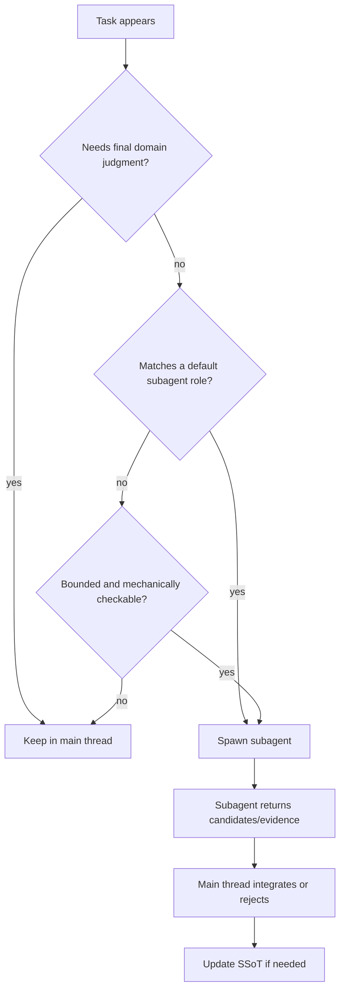

# Scrum Domain Modeling Subagent Contracts

Use these contracts when spawning subagents for `$scrum-domain-modeling`.

The main thread owns final domain judgment and SSoT document updates. Subagents produce candidates, audits, and evidence. They do not make final terminology or bounded-context decisions.

## Delegation Rule



## Shared Guardrails

- Pass only the minimum context needed for the subtask.
- Give one bounded source set, not the whole repository, unless the role explicitly needs it.
- Include fixed glossary terms when terminology matters.
- Require file/line or artifact references for claims.
- Require `Evidence`, `Confidence`, and `Questions returned to main thread` in every output.
- Require inferred items to be labeled as `candidate`, `assumption`, or `hotspot`.
- Ask the subagent to return questions instead of deciding uncertain domain points.
- Do not allow subagents to update SSoT documents directly.
- Do not let two subagents write to the same file.
- Close subagents when their result has been integrated or rejected.

## Spawn Message Template

```text
Role:
<one role below>

Goal:
<concrete bounded task>

Source files:
<exact files/directories/artifacts>

Workflow/context:
<one workflow or bounded context, if relevant>

Fixed terms:
<accepted glossary terms and meanings>

Output format:
<required bullets/table/JSON/Mermaid>

Non-goals:
<what not to decide/change/read>

Questions to return:
<questions the subagent must not resolve independently>
```

## Event Source Extractor

Use when extracting candidate business events and commands from exactly one source: one video OCR artifact, one article, one interview note, or one document.

Spawn message:

```text
Role:
Event Source Extractor

Goal:
Extract candidate business events and commands from one source only.

Source files:
<one video/article/document/OCR artifact>

Fixed terms:
<terms already accepted in data/domain-glossary.json>

Output format:
- Candidate event, in past tense
- Candidate command, if visible
- Actor/system, if visible
- Evidence/source location
- Confidence: high/medium/low
- Questions raised

Non-goals:
Do not decide final terminology.
Do not update SSoT documents.
Do not infer across other sources.
Do not create Mermaid diagrams.
Do not invent missing timeline steps unless they are labeled as questions or hotspots.

Questions to return:
Return unclear sequence, terminology, and missing actor questions.
```

## Organization Scope Auditor

Use when checking one code area for tenant-boundary safety.

Spawn message:

```text
Role:
Organization Scope Auditor

Goal:
Check whether one code area consistently scopes tenant data by organization.

Source files:
<one usecase/model/route area>

Fixed terms:
organizationId comes from authenticated tenant context.
userId comes from authenticated user context.
Every tenant-owned DB query must filter by organizationId.

Output format:
- Missing organization filter
- Cross-organization reference risk
- Good existing pattern
- File/line references
- Suggested test cases
- CRUD path checked: create/read/update/delete
- Classification: proven bug or needs-confirmation risk

Non-goals:
Do not refactor code.
Do not change domain terms.
Do not review unrelated modules.
Do not update SSoT documents.

Questions to return:
Return any ambiguous ownership or tenant-boundary assumptions.
```

## Mermaid Draft Worker

Use when the event/command/context list has already been approved and the task is only to produce diagram drafts.

Spawn message:

```text
Role:
Mermaid Draft Worker

Goal:
Create candidate Mermaid diagrams from the approved event/command/context list.

Source files:
<data/big-picture.json, data/workflow-models.json, or provided list>

Fixed terms:
Use only approved event, command, aggregate, read model, policy, and context names.

Output format:
- Mermaid event timeline
- Mermaid command -> aggregate -> event flow
- Mermaid read model / policy flow if applicable
- Mermaid context sketch if applicable
- Diagram assumptions
- Mermaid syntax notes

Non-goals:
Do not add new domain events.
Do not rename terms.
Do not update SSoT documents.
Do not decide context boundaries.
Do not present assumptions as accepted model facts.

Questions to return:
Return missing edges or ambiguous ordering.
```

## Workflow Test Planner

Use when the workflow is already modeled and the task is to list implementation tests for one slice.

Spawn message:

```text
Role:
Workflow Test Planner

Goal:
List test cases for one workflow slice.

Source files:
<workflow model and target usecase files>

Fixed terms:
Use lifecycle names and states from data/workflow-models.json.

Output format:
- Happy path tests
- Invalid path tests
- Organization scoping tests
- Transaction/effect tests
- Missing fixture/test helper needs
- File/line references when implementation exists
- Mapping from each proposed test to command/event/rule
- Already-covered vs missing, if tests exist

Non-goals:
Do not change implementation.
Do not broaden to other workflows.
Do not update SSoT documents.

Questions to return:
Return missing rules, unclear state transitions, and fixture gaps.
```

## Glossary Question Extractor

Use when extracting candidate terminology and open questions from one source.

Spawn message:

```text
Role:
Glossary Question Extractor

Goal:
Extract candidate glossary terms and open questions from one source.

Source files:
<one transcript/doc/source>

Fixed terms:
<current data/domain-glossary.json terms>

Output format:
- Candidate term
- Suggested definition
- Possible Code/API term if visible
- Do-not-confuse-with notes
- Open questions
- Evidence/source location
- Confidence: high/medium/low

Non-goals:
Do not decide final glossary entries.
Do not update SSoT documents.
Do not rename existing terms.
Do not resolve conflicts with fixed terms; flag them.

Questions to return:
Return term conflicts and terms that need domain-expert confirmation.
```

## Implementation Readiness Checker

Use when the main thread has a candidate model and wants a mechanical readiness audit before accepting implementation work into a sprint.

Spawn message:

```text
Role:
Implementation Readiness Checker

Goal:
Check whether one workflow/context is implementation-ready.

Source files:
<workflow/context docs, event-command map, context map, open questions, relevant implementation plan>

Fixed terms:
Use the readiness criteria in the HTML plan or the skill instructions.

Output format:
- Pass/fail/unknown per readiness item
- Evidence/source location
- Confidence: high/medium/low
- Blocking open questions
- Documents that need updates before implementation

Readiness items:
- Workflow name and purpose
- Domain experts who validated it
- Commands that trigger it
- Input data and dependencies
- Output events
- Side effects
- Invalid paths and error events
- Lifecycle states and constraints
- Bounded context owner
- Cross-context relationships
- DTO/contract shape for external communication
- Trust boundary validation
- Domain model data updated and rendered

Non-goals:
Do not decide unresolved domain questions.
Do not update SSoT documents.
Do not broaden to other workflows.

Questions to return:
Return missing evidence, unresolved domain questions, and readiness items that are blocked.
```
